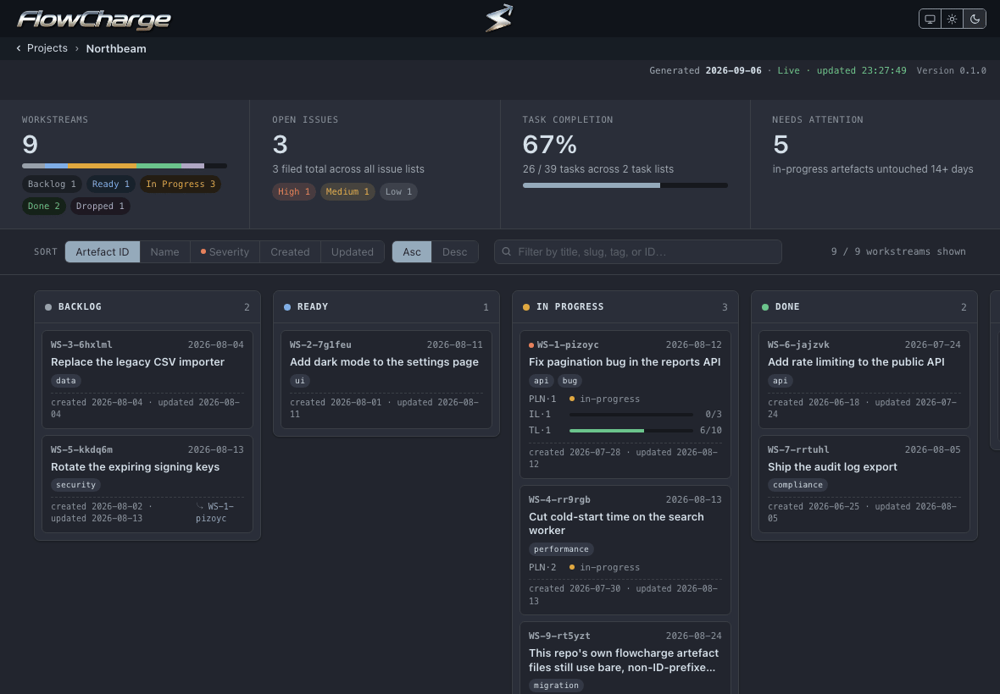

```
███████╗██╗      ██████╗ ██╗    ██╗ ██████╗██╗  ██╗ █████╗ ██████╗  ██████╗ ███████╗
██╔════╝██║     ██╔═══██╗██║    ██║██╔════╝██║  ██║██╔══██╗██╔══██╗██╔════╝ ██╔════╝
█████╗  ██║     ██║   ██║██║ █╗ ██║██║     ███████║███████║██████╔╝██║  ███╗█████╗  
██╔══╝  ██║     ██║   ██║██║███╗██║██║     ██╔══██║██╔══██║██╔══██╗██║   ██║██╔══╝  
██║     ███████╗╚██████╔╝╚███╔███╔╝╚██████╗██║  ██║██║  ██║██║  ██║╚██████╔╝███████╗
╚═╝     ╚══════╝ ╚═════╝  ╚══╝╚══╝  ╚═════╝╚═╝  ╚═╝╚═╝  ╚═╝╚═╝  ╚═╝ ╚═════╝ ╚══════╝
```

**FlowCharge is a markdown project-management suite that runs in your agent sessions,
writing every plan, issue and task into your repository to keep the project on
track.**

  



## What it is

FlowCharge is the application. It reads the `flowcharge/` folder in any project and
renders every workstream as a card on a local board: backlog, ready, in progress,
done, dropped. Each card carries its plan, its issues and its task progress. It
installs the FlowCharge Core skill files and tracks their versions. One plain-English
request becomes an ordered pipeline your coding agent runs: investigate, plan, file,
task, execute, commit. One setting decides how much of that comes back to you before
it lands.

This repository holds the FlowCharge binaries and documentation. FlowCharge is free
to use, and its source stays unpublished.

## Install

With Homebrew:

```sh
brew install FlowChargeApp/flowcharge/flowcharge
flowcharge
```

Open `http://localhost:4173`, paste a project's absolute path, and click its tile. If
the project has no `flowcharge/` folder yet, FlowCharge offers to create one.

Or download the binary from the
[Releases page](https://github.com/FlowChargeApp/flowcharge/releases): macOS on Apple
Silicon and Intel, and Linux x64. The binary is self-contained and needs nothing
else installed.

## Try it

Install FlowCharge Core into your coding tool from the Manage integrations screen,
then give your agent these prompts in order, one at a time or all at once:

```
Create a workstream to add a CSV export to the reports page.
Write up a plan
Open tasks
Execute all tasks, committing after each task.
List what is in flight
```

Watch the board while your agent works: it updates on its own, and every card, issue
and task on it comes from the files your agent just wrote.

## How it works

Your coding agent keeps a `flowcharge/` folder in each project, with one sub-folder
per workstream holding that workstream's plan, issues and tasks as markdown, status
in the frontmatter. FlowCharge reads those files fresh on every request, so the board
is never older than the files. The full model is in
[FlowCharge Core](https://github.com/FlowChargeApp/flowcharge-core).

## Works with

- Claude Code, Cursor, Windsurf, OpenCode and OpenAI Codex: the coding tools
  FlowCharge installs Core into.
- macOS on Apple Silicon and Intel, and Linux x64, each as one self-contained binary
  (Windows version coming soon).
- Any project folder, whatever the language. FlowCharge offers to create the
  `flowcharge/` folder when a project has none.

## The other half

[FlowCharge Core](https://github.com/FlowChargeApp/flowcharge-core) is the free,
open-source skill suite that does the work FlowCharge shows. Each works without the
other: Core runs with no application installed, and FlowCharge reads any
`flowcharge/` folder, whoever wrote it.

---

FlowCharge is free to use, and its source is not published.
To report a vulnerability, see [SECURITY.md](SECURITY.md).
Copyright © 2026 Anthony Koukoullis. All rights reserved.
